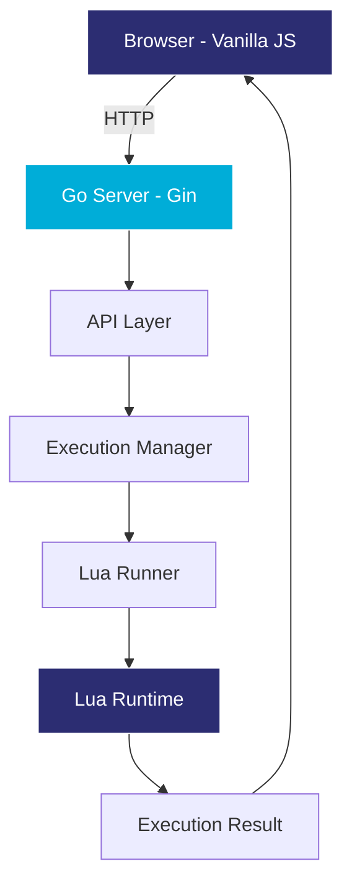

 <div align="center">


# Lua Runner

### Write. Run. Inspect.

*A browser-based Lua playground powered by Go.*

<br/>

[](https://go.dev/)
[](https://gin-gonic.com/)
[](https://www.lua.org/)
[](https://developer.mozilla.org/en-US/docs/Web/JavaScript)
[](https://developer.mozilla.org/en-US/docs/Web/HTML)
[](https://developer.mozilla.org/en-US/docs/Web/CSS)
[](https://www.docker.com/)


<br/>

[**Overview**](#overview) •
[**Features**](#features) •
[**Architecture**](#architecture) •
[**API**](#api) •
[**Security**](#security--isolation) •
[**Getting Started**](#getting-started) •
[**Roadmap**](#roadmap)

</div>

<br/>

---

## Overview

**Lua Runner** is a web application that lets you write and execute Lua code directly in your browser, with no local Lua installation required.

The backend is built with **Go** and **Gin**, handling execution requests and managing the Lua runtime. The goal is a simple, safe, and fast coding environment.

```lua
-- Try it
print("Hello from Lua")
```

## Features

| Feature | Status |
| :--- | :-: |
| Write and run Lua code in the browser | In Progress |
| Execute submitted code through a Go backend | In Progress |
| Capture standard output and standard error | In Progress |
| Display execution status and duration | In Progress |
| Handle syntax and runtime errors | In Progress |
| Enforce execution timeouts | In Progress |
| Isolated execution environments | Planned |

## Technology Stack

| Technology | Purpose |
| :--- | :--- |
| **Go** | Backend and execution management |
| **Gin** | HTTP framework |
| **Lua 5.4** | Code execution runtime |
| **Vanilla JavaScript** | Frontend logic |
| **HTML5** | Application structure |
| **CSS3** | Styling |
| **Monaco Editor** | Code editor |
| **Docker** | Execution isolation (planned) |

## Architecture



### Components

| Component | Responsibility |
| :--- | :--- |
| **API Layer** | Handles incoming requests, validates submitted code, and returns execution results. |
| **Execution Manager** | Manages execution jobs, handles timeouts, and controls the execution lifecycle. |
| **Lua Runner** | Runs submitted Lua code and captures stdout, stderr, and exit status. |
| **Web Interface** | Provides the code editor and displays execution results. |

## Project Structure

```text
lua-runner/
├── cmd/
│   └── server/
│       └── main.go          # Application entry point
├── internal/
│   ├── api/
│   │   ├── handlers.go      # HTTP handlers
│   │   └── routes.go        # Route registration
│   └── execution/
│       ├── manager.go       # Job & lifecycle management
│       ├── result.go        # Execution result types
│       └── runner.go        # Lua process runner
├── web/
│   ├── app.js               # Frontend logic
│   ├── index.html           # Page structure
│   └── styles.css           # Styling
├── go.mod
├── README.md
├── TODO.md
└── Lua small runner.md
```

## API

### `POST /api/runs`

Submits Lua source code to the backend for execution.

<table>
<tr>
<td width="50%" valign="top">

**Request**

```json
{
  "code": "print('Hello from Lua')"
}
```

</td>
<td width="50%" valign="top">

**Response**

```json
{
  "id": "run_123",
  "status": "completed",
  "stdout": "Hello from Lua\n",
  "stderr": "",
  "exit_code": 0,
  "duration_ms": 12
}
```

</td>
</tr>
</table>

### Execution Status

| Status | Description |
| :--- | :--- |
| `queued` | Waiting for execution |
| `running` | Currently executing |
| `completed` | Execution completed successfully |
| `failed` | Execution failed |
| `timed_out` | Execution exceeded its time limit |
| `cancelled` | Execution was cancelled |

> [!NOTE]
> The initial implementation uses a **synchronous** execution flow. Asynchronous job management is planned for a later stage.

## Security & Isolation

> [!WARNING]
> Every submitted program must be treated as **untrusted**. Do not expose this project to arbitrary public code execution until its isolation mechanisms have been implemented and tested.

**Planned security measures**

- Execution time limits
- CPU and memory restrictions
- Restricted filesystem access
- Network access disabled by default
- Process and file descriptor limits
- Output size restrictions
- Temporary execution environments with automatic cleanup

**Isolation technologies**

| Technology | Purpose |
| :--- | :--- |
| **Docker** | Initial container-based isolation |
| **gVisor** | Additional execution isolation |
| **Firecracker** | MicroVM-based isolation |

Docker is the planned starting point. Other technologies may be considered depending on deployment requirements.

> The backend manages execution; the sandbox contains execution.

## Getting Started

### Requirements

- [Go](https://go.dev/dl/)
- [Lua 5.4](https://www.lua.org/download.html)
- [Git](https://git-scm.com/)

### Installation

```bash
# Clone the repository
git clone <repository-url>
cd lua-runner

# Install dependencies
go mod download

# Run the server
go run ./cmd/server
```

> [!TIP]
> Server configuration and runtime setup may change during development.

## Roadmap

<details open>
<summary><b>Phase 1 · Local Lua Execution</b></summary>

- [ ] Integrate Lua 5.4
- [ ] Execute Lua code through Go
- [ ] Capture stdout and stderr
- [ ] Handle syntax and runtime errors
- [ ] Implement execution timeouts

</details>

<details>
<summary><b>Phase 2 · HTTP API</b></summary>

- [ ] Integrate Gin
- [ ] Implement `POST /api/runs`
- [ ] Validate execution requests
- [ ] Return structured JSON responses

</details>

<details>
<summary><b>Phase 3 · Web Interface</b></summary>

- [ ] Build the browser editor
- [ ] Integrate Monaco Editor
- [ ] Connect the frontend to the API
- [ ] Display execution results

</details>

<details>
<summary><b>Phase 4 · Execution Isolation</b></summary>

- [ ] Implement Docker-based isolation
- [ ] Apply CPU and memory limits
- [ ] Restrict filesystem access
- [ ] Disable network access
- [ ] Implement automatic cleanup

</details>

<details>
<summary><b>Phase 5 · Job Management</b></summary>

- [ ] Introduce job IDs and lifecycle states
- [ ] Implement bounded concurrency
- [ ] Add execution cancellation
- [ ] Add resource limits

</details>

<details>
<summary><b>Phase 6 · Future Improvements</b></summary>

- [ ] Execution history
- [ ] Persistent projects
- [ ] Multiple Lua versions
- [ ] Interactive input
- [ ] Support for additional programming languages

</details>

## Project Goals

- Learn and apply backend engineering concepts
- Understand process and execution management
- Explore operating system resource controls
- Build a secure code execution environment
- Design a modular and maintainable backend

## Contributing

Contributions and suggestions are welcome! Feel free to [open an issue](../../issues) or submit a pull request.

## License

License information will be added when the project license is selected.

<br/>

<div align="center">

**Built using Go and Lua**

</div>
